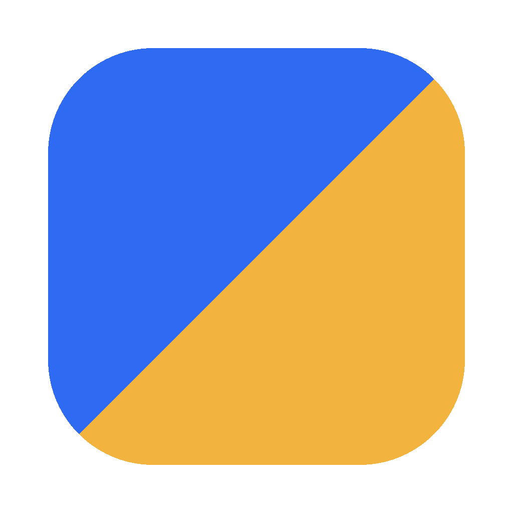

# Boardly

A free, local-first visual board app for notes, images, to-dos, links and sketches on an endless canvas. No account, no cloud. Your boards stay on your computer. Export any board to **Word, PowerPoint or PDF**.

**▶ Use it in your browser:** https://efter-dash.github.io/boardly/

**⬇ Download for Windows or Mac:** [Latest release](https://github.com/efter-dash/boardly/releases/latest)



## Features

- **Endless canvas:** pan with scroll or Space + drag, and zoom with Ctrl/⌘ + scroll or pinch
- **Cards:** rich-text notes (with a full-screen document mode), headings, to-do lists with progress, links, images, files (audio and video play inline), YouTube/Vimeo videos, colour swatches, sketches and comments
- **Boards inside boards** with breadcrumbs, **columns** to stack cards, and **arrows** between cards (with labels and colours)
- Card colours, resize, multi-select, duplicate, copy/paste between boards, undo/redo and snap to grid
- Drag and drop or paste images, files, links and text
- **Templates:** Moodboard, Project plan, Brainstorm, Weekly planner, Storyboard and Meeting notes
- Search across every board, a Trash with restore, light and dark themes, and keyboard shortcuts

## Export

| Format | What you get |
| --- | --- |
| Word (.docx) | Editable text, headings, lists, tasks, links, colour swatches and images |
| PowerPoint (.pptx) | Editable slides: the board laid out as shapes and arrows, plus slides per column, notes and images |
| PDF | A picture of the board plus a text outline |
| PNG, Markdown, .json | Image, plain text, or a Boardly file you can import again |

**Export only some cards:** select the cards you want (Shift-click, or drag a box around them), right-click, and choose **Export selected cards…**. You get the same formats, with only those cards, so the files stay small.

## Where your data lives

Boards are saved in local storage on your device (IndexedDB). The browser version and the desktop app each keep their own separate data. Use **⋯ → Back up all boards** to save a `.json` file, and **⋯ → Import backup** to restore it or move to another computer.

## Install

See the [latest release](https://github.com/efter-dash/boardly/releases/latest) for Windows (installer or portable), Mac (Apple chip or Intel) and a browser version that runs from a folder. The builds aren't signed with a paid developer certificate, so the first launch asks you to confirm:

- **Windows:** click **More info → Run anyway**.
- **Mac:** go to **System Settings → Privacy & Security → Open Anyway**.

## Run from source

```bash
npm install
npm start
```

Or just open `app/index.html` in a browser. To build installers: `npm run dist:mac` or `npm run dist:win`. Pushing a tag like `v1.0.1` builds both and publishes a release automatically.

## Known limits

- The PDF text outline uses built-in PDF fonts, so non-Latin scripts (e.g. Bangla) appear only in the board picture on page 1. Word and PowerPoint keep all text.
- There is no real-time collaboration or sharing. By design, everything stays on your device.

## License

MIT
